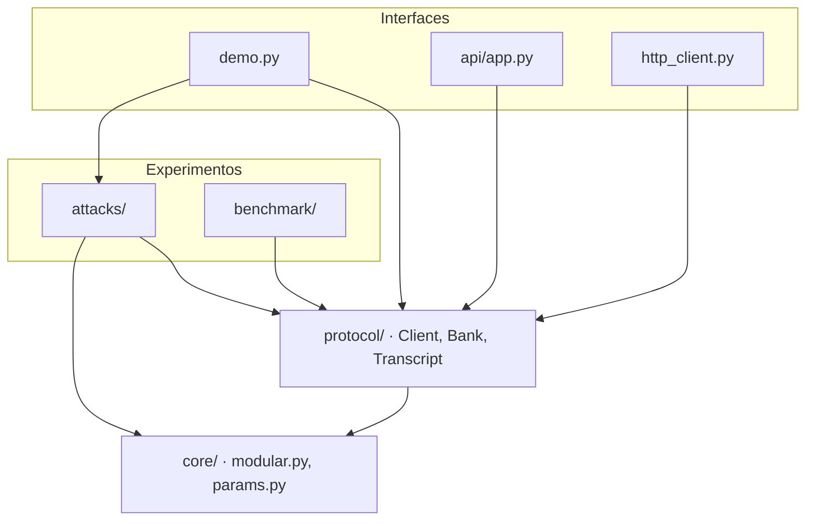

# Schnorr Lab

[](https://github.com/Djch18AtSchool/schnorr-lab/actions/workflows/tests.yml)

Implementación en Python, desde cero, del **protocolo de identificación de Schnorr** para que el cliente de una aplicación bancaria inicie sesión **sin enviar ni guardar su clave secreta** en el servidor. El proyecto incluye un laboratorio de ataques controlados y una API HTTP para probar el protocolo con cliente y servidor separados.

> Proyecto del curso **Matemática Discreta 2** (FUN-03), Universidad CENFOTEC, C3-2026. Docente: Rebeca Paola Chaves Morales.
> Integrantes: Maximiliano Badilla Cerdas, Braden Lee Knuter Cordoba, Dylan Josue Chaves Hernández y Dylan Gabriel Piña Moya.
>
> Es un **modelo educativo**: implementa la matemática discreta que sustenta la autenticación. No debe usarse en producción; un sistema real usa bibliotecas criptográficas auditadas.

## Revisión en cuatro comandos

```bash
python demo.py --verbose --option 1     # ejemplo p = 23, paso a paso
pytest                                  # pruebas + tabla de trazabilidad
uvicorn api.app:app --reload            # API: abrir http://127.0.0.1:8000/docs
python http_client.py                   # inicio de sesión por HTTP, mostrando lo que viaja
```

`http_client.py` necesita la API corriendo en otra terminal. Las salidas de estos comandos están guardadas en [`docs/evidencia/`](docs/evidencia/).

## Instalación

Requiere **Python 3.12**. Desde la raíz del repositorio:

```bash
python -m venv .venv
source .venv/bin/activate          # Windows: .venv\Scripts\activate
pip install -e ".[dev]"            # o: pip install sympy matplotlib fastapi uvicorn httpx pytest
```

## Estado del segundo avance

Coincide con la Tabla 5 del escrito: lo que el escrito declara funcional para este avance funciona y tiene pruebas. Lo que queda para el informe final está en esqueleto, con firmas, docstrings y `NotImplementedError`. Sus pruebas ya están escritas como contrato y aparecen como *pendientes* (`xfailed`) en la tabla de trazabilidad.

| Componente | Requerimientos | Segundo avance | Informe final |
| --- | --- | --- | --- |
| `core/modular.py` | R4, R5 | ✅ Funcional, verificado contra `pow` y SymPy | — |
| `core/params.py` | R1, R7 | ✅ Grupo de ejemplo, validación y primos seguros de 256, 512 y 1024 bits (en `core/groups.json`) | Grupos RFC 3526 y de Schnorr |
| `protocol/` (Client, Bank, Transcript) | R2, R3, R6, R9 | ✅ Funcional, con control de intentos | — |
| `protocol/fiat_shamir.py` | R8 | Esqueleto | Funcional |
| `attacks/nonce_reuse.py`, `simulator.py`, `impostor.py` | R10 | ✅ Funcionales | — |
| `attacks/replay.py`, `bsgs.py`, `stolen_db.py` | R10 | Esqueleto | Funcionales, con gráficas |
| `benchmark/latency.py` | R7 | Esqueleto | Tabla y gráficas |
| `demo.py` | R11 | ✅ Opciones 1, 2, 4 y 7 | Menú completo |
| `api/app.py`, `http_client.py` | R11 | ✅ Registro, compromiso, respuesta y auditoría | Endpoint no interactivo |

Resultado de `pytest`: **131 pruebas aprobadas y 14 pendientes para el informe final**.

## El protocolo en una pantalla

`python demo.py --option 1` reproduce la transcripción del escrito (p = 23, q = 11, g = 4, x = 7, r = 5, c = 3):

```
[Parámetros]    p = 23   q = 11   g = 4        (g^q ≡ 1 mod p ✔)
[Registro]      x = 7 (secreta)  →  y = 4^7 mod 23 = 8   (el banco guarda solo y)
[Compromiso]    r = 5  →  t = 4^5 mod 23 = 12
[Reto]          c = 3
[Respuesta]     s = 5 + 3·7 mod 11 = 4
[Verificación]  g^s = 4^4 mod 23 = 3   |   t·y^c = 12·8^3 mod 23 = 3
                (y^c)^-1 = 6^-1 = 4 (Euclides extendido) → g^s·(y^c)^-1 = 12 = t ✔
>>> ACCESO CONCEDIDO
```

Con `--verbose` se agregan los pasos de la exponenciación rápida (un renglón por bit del exponente) y las divisiones y el despeje del Algoritmo Extendido de Euclides.

Menú (`python demo.py`): 1 paso a paso con p = 23 · 2 autenticación en el grupo elegido (`--group toy|safe-256|safe-512|safe-1024`) y bloqueo al tercer fallo · 3 Fiat-Shamir · 4 laboratorio de ataques · 5 latencia · 6 BSGS · 7 pruebas · 0 salir. Las opciones del informe final responden «Disponible en el informe final».

## Probar la API con clics (Swagger)

Con `uvicorn api.app:app --reload` y el grupo por defecto (`toy`, p = 23), en http://127.0.0.1:8000/docs:

1. `POST /demo/client` con `{"user_id": "cliente01", "x": "7"}` → devuelve `y = "8"`. Es solo una ayuda para Swagger: está separado del banco y no queda en la auditoría.
2. `POST /register` con `{"user_id": "cliente01", "y": "8"}`.
3. Con r = 5, el compromiso es t = 4⁵ mod 23 = 12: `POST /login/commit` con `{"user_id": "cliente01", "t": "12"}` → el banco responde `session_id` y un reto `c` aleatorio. Si se pide otro reto sin responder este, la sesión pendiente se descarta y cuenta como intento fallido.
4. Calcular s = (5 + 7·c) mod 11 con la tabla y enviar `POST /login/respond` con `{"session_id": "...", "s": "..."}`.

   | c | 0 | 1 | 2 | 3 | 4 | 5 | 6 | 7 | 8 | 9 | 10 |
   | --- | --- | --- | --- | --- | --- | --- | --- | --- | --- | --- | --- |
   | s | 5 | 1 | 8 | 4 | 0 | 7 | 3 | 10 | 6 | 2 | 9 |

5. `GET /bank/users` muestra que el banco guarda solo `y`, y `GET /audit/log` muestra todo lo que recibió: x nunca aparece.

Para otro tamaño de p: `SCHNORR_GROUP=safe-512 uvicorn api.app:app`. Todos los enteros viajan como **cadenas decimales**, porque JavaScript (y Swagger) pierde precisión por encima de 2⁵³.

| Método y ruta | Cuerpo | Respuesta |
| --- | --- | --- |
| `GET /params` | — | `{name, p, q, g, bits}` |
| `POST /register` | `{user_id, y}` | 201 `{user_id, stored: {y}}`; 400 con `reason` |
| `POST /login/commit` | `{user_id, t}` | `{session_id, c}`; 400 si t está fuera del subgrupo; 404 si el usuario no existe; 423 si está bloqueado |
| `POST /login/respond` | `{session_id, s}` | `{accepted, reason, transcript, details, attempts_left}` |
| `GET /bank/users` | — | `{user_id: y}` |
| `GET /audit/log` | — | Cuerpos recibidos por el banco, en orden, incluidos los rechazados por mal formados (`valid: false`) |
| `POST /demo/client` | `{user_id, x?}` | x e y de un cliente de prueba (solo demostración) |

## Arquitectura



Las flechas indican «usa». Toda la matemática vive en `core/`. Las interfaces solo importan `protocol/`, que les reexporta la selección de grupos. Los ataques son la única excepción y llaman directo a `core/`, por ejemplo a `mod_inverse` para extraer x. Ningún módulo de una capa inferior importa uno de una capa superior.

```
schnorr_lab/
├── core/
│   ├── modular.py      mod_pow, extended_gcd, mod_inverse
│   ├── params.py       GroupParams, validate_params, in_subgroup, generator_for, get_group
│   └── groups.json     primos seguros de 256, 512 y 1024 bits ya generados
├── protocol/
│   ├── client.py       Client: register_payload, commit, respond
│   ├── bank.py         Bank: register, challenge, verify
│   ├── transcript.py   Transcript (t, c, s), VerifyResult, Reason
│   └── fiat_shamir.py  prove, verify_nizk                    (esqueleto)
├── attacks/
│   ├── nonce_reuse.py  extract_secret, FaultyClient
│   ├── simulator.py    simulate, enumerate_real, enumerate_simulated
│   ├── impostor.py     impostor_rate
│   ├── replay.py       replay_experiment                     (esqueleto)
│   ├── bsgs.py         bsgs                                  (esqueleto)
│   └── stolen_db.py    stolen_db_experiment                  (esqueleto)
├── benchmark/
│   └── latency.py      measure_auth, measure, plot           (esqueleto)
├── api/
│   ├── app.py          API HTTP del banco (FastAPI)
│   └── schemas.py      esquemas de petición y respuesta
├── tests/              pruebas por requerimiento + tabla de trazabilidad (conftest.py)
├── results/            gráficas y tablas generadas (informe final)
├── docs/evidencia/     salidas capturadas para el informe
├── demo.py             menú principal y modo --verbose
└── http_client.py      cliente que inicia sesión por HTTP
```

### Del diagrama de flujo al código (Tabla 6 del escrito)

| Nodo de la Figura 1 | Función que lo implementa |
| --- | --- |
| Generar o cargar (p, q, g) | `core/params.py` → `get_group` |
| ¿Parámetros válidos? | `core/params.py` → `validate_params` |
| Cliente elige x y calcula y | `protocol/client.py` → `Client.__init__`, `Client.register_payload` |
| ¿y en el subgrupo? / Guardar (id, y) | `protocol/bank.py` → `Bank.register`, con `params.in_subgroup` |
| Cliente elige r y envía t | `protocol/client.py` → `Client.commit` |
| ¿t en el subgrupo? / Banco elige c | `protocol/bank.py` → `Bank.challenge` |
| Cliente calcula s | `protocol/client.py` → `Client.respond` |
| ¿Prueba válida? | `protocol/bank.py` → `Bank.verify`, con `modular.mod_pow` y `modular.mod_inverse` |
| Sumar intento / ¿Menos de 3 fallos? / Bloquear | `protocol/bank.py` → `Bank._fail`, `Bank._abandon_pending_session`, `Bank.is_locked` |

### Objetos y estructuras discretas en el código

| Estructura del escrito | Dónde está |
| --- | --- |
| Grupo Zp\* y subgrupo de orden q | `GroupParams(p, q, g)`; pertenencia con `in_subgroup` (u^q ≡ 1 mod p) |
| Enteros modulares y congruencias | `mod_pow`, `mod_inverse` y la comparación g^s ≡ t·y^c en `Bank.verify` |
| Transcripción (t, c, s) | `Transcript`, inmutable (`dataclass(frozen=True)`) |
| Registro de usuarios: id → y | `Bank._users: dict[str, int]` |
| Sesiones e intentos | `Bank._sessions: dict[str, (id, t, c)]`, de un solo uso; `Bank._open_sessions: dict[str, str]` (a lo sumo una sesión pendiente por usuario); `Bank._failures: dict[str, int]` |
| Conjunto de pruebas usadas | `Bank._used_proofs: set[(t, s)]` (lo usará Fiat-Shamir) |

## Pruebas y trazabilidad (Tabla 7 del escrito)

Cada prueba lleva `@pytest.mark.req("Rn")`. Al terminar, `pytest` imprime cada prueba con su requerimiento y un resumen por requerimiento. Las pruebas lentas se omiten con `pytest -m "not slow"`, que es lo que corre GitHub Actions en cada *push* y *pull request*.

| ID | Criterio de aceptación del escrito | Pruebas |
| --- | --- | --- |
| R1 | (23, 11, 4) se acepta; (23, 11, 1) y (21, 10, 4) se rechazan | `tests/test_params.py` |
| R2 | El banco guarda solo id → y | `tests/test_protocol.py` (también revisa que x no esté en ningún dato del banco) |
| R3 | En 1000 inicios de sesión con q de al menos 256 bits no se repite r ni c | `tests/test_protocol.py` |
| R4 | `mod_pow` coincide con `pow` en 1000 casos y 4⁷ mod 23 = 8 | `tests/test_modular.py` |
| R5 | `mod_inverse` coincide con SymPy en 1000 casos y 6⁻¹ mod 23 = 4 | `tests/test_modular.py` |
| R6 | (12, 3, 4) se acepta; con s = 5 se rechaza | `tests/test_protocol.py` |
| R7 | Autenticación honesta aceptada con cada tamaño de p (toy, 256, 512, 1024); 2048 y latencia, pendientes | `tests/test_protocol.py`, `tests/test_params.py`, `tests/test_pending.py` |
| R8 | Prueba válida aceptada; repetida o con m vieja rechazada (pendiente) | `tests/test_fiat_shamir.py` |
| R9 | s = 11, t = 5 e y = 1 se rechazan; el cuarto intento se rechaza aunque sea válido | `tests/test_protocol.py`, `tests/test_api.py` |
| R10 | x = 7 recuperada por reutilización de r; simuladas = reales y válidas; impostor ≈ 9.09 % | `tests/test_attacks.py`, `tests/test_pending.py` |
| R11 | Flujo completo por la API aceptado y x ausente de todo mensaje; opción 1 idéntica al escrito | `tests/test_api.py`, `tests/test_demo.py` |

### Decisiones de implementación que conviene conocer

- **Rango de r.** El cliente toma r ∈ [1, q − 1], como dice la Tabla 1. Por eso, con p = 23 el cliente real produce q·(q − 1) = **110** transcripciones distintas. El simulador recorre los q² pares (c, s) y descarta t = 1, que un cliente honesto nunca envía. Así obtiene exactamente las mismas 110, sin conocer x. Con r = 0 se tendría t = 1 y s = c·x, lo que delataría x.
- **Primo seguro.** `validate_params` exige p = 2q + 1, como pide R1. Los grupos de Schnorr del informe final (q mucho menor que p) se validarán con `require_safe_prime=False`.
- **«x no viaja» con p = 23.** `http_client.py` siempre verifica que solo viajen los campos públicos `user_id, y, t, session_id, s`. Que el *valor* de x no aparezca es concluyente con q grande. Con q = 11, un t o un s puede coincidir con x por azar (probabilidad ≈ 1/q), así que eso se informa como nota y no como fuga. La prueba automática de R11 usa `safe-256`.
- **Intentos abandonados.** Cada usuario tiene a lo sumo una sesión pendiente. Pedir un reto nuevo sin responder el anterior descarta esa sesión y la cuenta como intento fallido. Sin esta regla, un impostor podría abrir retos sin responderlos hasta que saliera el c que adivinó, sin que nunca se le contara un fallo.
- **Impostor.** Para medir la probabilidad por intento (1/q), el experimento desactiva el bloqueo. Con el bloqueo a los 3 fallos y la regla anterior, la probabilidad de entrar es a lo sumo 1 − (1 − 1/q)³.
- **Auditoría completa.** `/audit/log` guarda también los cuerpos que el banco rechazó por mal formados (por ejemplo, uno que trajera un campo `x`). La respuesta 422 explica el motivo en español sin repetir la entrada.

## Convenciones del código

- **Idioma:** identificadores, funciones y archivos en inglés; comentarios, docstrings y mensajes en pantalla en español.
- **Matemática propia:** dentro de `core/`, `protocol/` y `attacks/` no se usa `pow(a, b, n)` ni `pow(a, -1, n)`, sino siempre `mod_pow` y `mod_inverse`. El `pow` nativo y SymPy se usan en las pruebas para contrastar. SymPy además se usa para la primalidad.
- **Aleatoriedad:** solo `secrets` (x, r, c, identificadores de sesión y búsqueda de primos).
- **Errores:** las validaciones devuelven un resultado con `accepted=False` y un `reason` en español. Las excepciones quedan para el uso incorrecto del código (por ejemplo, `mod_inverse` sin inverso).
- **Docstrings:** cada función pública indica el requerimiento que cubre («Cubre R4.») y la definición del marco teórico que implementa.
- **Tipos:** anotaciones en todas las firmas públicas y `dataclass(frozen=True)` para los valores inmutables.
- **Git:** rama `main` protegida; una rama por tarea (`feat/bank-verify`, `test/r6`); cada *pull request* debe pasar las pruebas en GitHub Actions. Mensajes con el formato *conventional commits*.

Para regenerar los primos seguros: `python -m core.params --generate 256 512 1024`. Si falta alguno en `core/groups.json`, se genera solo la primera vez que se pide; el de 1024 bits tarda unos segundos.

## Referencias

- Schnorr, C. P. (1991). Efficient signature generation by smart cards. *Journal of Cryptology, 4*(3), 161–174.
- Menezes, A. J., van Oorschot, P. C. y Vanstone, S. A. (1996). *Handbook of applied cryptography*. CRC Press.
- Katz, J. y Lindell, Y. (2020). *Introduction to modern cryptography* (3.ª ed.). CRC Press.
- Rosen, K. H. (2019). *Discrete mathematics and its applications* (8.ª ed.). McGraw-Hill Education.
- Hao, F. (2017). *Schnorr non-interactive zero-knowledge proof* (RFC 8235). IETF.
- Kivinen, T. y Kojo, M. (2003). *More modular exponential (MODP) Diffie-Hellman groups for IKE* (RFC 3526). IETF.
