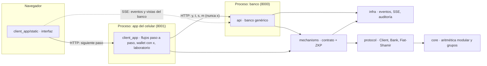

# Schnorr Lab

[](https://github.com/Djch18AtSchool/schnorr-lab/actions/workflows/tests.yml)

Laboratorio de **autenticación bancaria sin contraseñas** con una prueba de conocimiento cero: el **protocolo de identificación de Schnorr**, implementado desde cero en Python. El cliente demuestra al banco que conoce una clave secreta *x* sin enviarla nunca; el banco guarda solo la clave pública *y = g<sup>x</sup> mod p*.

El entregable es el propio sistema funcionando en tiempo real. Una app bancaria simulada en el celular y un banco corren como procesos separados. La interfaz permite recorrer cada paso del protocolo, ver qué viaja por la red y qué guarda el banco, lanzar ataques en vivo y consultar las mediciones del laboratorio.

> Proyecto del curso **Matemática Discreta 2** (FUN-03), Universidad CENFOTEC, C3-2026. Docente: Rebeca Paola Chaves Morales.
> Integrantes: Maximiliano Badilla Cerdas, Braden Lee Knuter Cordoba, Dylan Josue Chaves Hernández y Dylan Gabriel Piña Moya.
>
> Es un **modelo educativo**: implementa la matemática discreta que sustenta la autenticación. No debe usarse en producción; un sistema real usa bibliotecas criptográficas auditadas.

## Cómo ejecutarlo

Requiere **Python 3.12**. Desde la raíz del repositorio:

```bash
python -m venv .venv
source .venv/bin/activate          # Windows: .venv\Scripts\activate
pip install -e ".[dev,bench]"      # bench agrega gmpy2, solo para comparar implementaciones
```

| Comando | Qué hace |
| --- | --- |
| `python lab.py` | Arranca el banco (puerto 8000) y la app del celular (8001). Abrir **http://127.0.0.1:8001** |
| `pytest` | 360 pruebas y la tabla de trazabilidad requerimiento → prueba → resultado |
| `python -m benchmark.compare` | Compara el ZKP con contraseña, TOTP y SRP (unos 20 s) |
| `python demo.py --verbose --option 1` | El ejemplo del escrito (p = 23) paso a paso en la consola |
| `python -m benchmark.latency` | Vuelve a medir la latencia según los bits de p (unos 30 s) |

Otras formas de usarlo: `uvicorn api.app:app` levanta solo el banco (Swagger en http://127.0.0.1:8000/docs); `python http_client.py` inicia sesión por HTTP mostrando lo que viaja; `python lab.py --group rfc-2048` arranca con un grupo de 2048 bits.

## Qué se ve en la demostración

- **Celular (izquierda):** la app del banco. Se crea una cuenta y se inicia sesión con el ZKP interactivo o con la variante no interactiva (Fiat-Shamir). Con «Paso a paso», cada cálculo y cada mensaje se ejecuta cuando se pide, para explicarlo.
- **Flujo:** diagrama de secuencia celular ↔ red ↔ banco que se anima con cada paso. Para el paso elegido muestra la explicación, la fórmula, los valores (incluida la traza bit a bit de la exponenciación con p pequeño), el mensaje HTTP y lo que hizo el banco al recibirlo.
- **Red:** cada mensaje tal como viajó. Una verificación automática confirma que solo viajaron campos públicos (`user_id, y, t, session_id, s, m`).
- **Banco:** lo que guarda (solo *y*), los parámetros públicos, la auditoría de todo cuerpo recibido (también los rechazados) y, aparte, lo que guarda el celular.
- **Laboratorio:** ataques en vivo contra el banco que está corriendo (repetir mensajes capturados, robar la base de datos, suplantar sin *x*) y los experimentos de `attacks/`.
- **Resultados:** gráficas y tablas de latencia y de BSGS, generadas de antemano.
- **Consola del banco (`/consola/`):** lo que ve el banco en tiempo real. Resumen (indicadores y cada petición en el tiempo), Actividad (cada intento params → commit → respond con el log, la función y los cálculos del banco), Seguridad (alertas por dispositivo de origen con su evidencia), Clientes (lo único que guarda: *y*), Laboratorio, Pruebas y Sistema.
- **Swagger:** la API del banco; lo que entre por ahí también aparece en la auditoría y en la consola.

El selector de grupo en la barra superior reinicia el laboratorio con otro tamaño de p (de p = 23 hasta 3072 bits) para mostrar en vivo cómo cambia la latencia.

## Estado: todos los requerimientos implementados

| ID | Requerimiento (Tabla 4 del escrito) | Dónde | Pruebas |
| --- | --- | --- | --- |
| R1 | Parámetros públicos válidos (p, q primos, p = 2q + 1, g^q ≡ 1) | `core/params.py`, `core/rfc3526.py` | `test_params.py` |
| R2 | El banco guarda solo y | `protocol/bank.py`, `mechanisms/zkp/server.py` | `test_protocol.py`, `test_client_app.py` |
| R3 | r y c nuevos en cada sesión | `protocol/client.py`, `protocol/bank.py` | `test_protocol.py` |
| R4 | Potencia modular rápida propia | `core/modular.py` | `test_modular.py`, `test_backends.py` |
| R5 | Inverso modular con Euclides extendido | `core/modular.py` | `test_modular.py` |
| R6 | Verificación g^s ≡ t·y^c (mod p) | `protocol/bank.py` | `test_protocol.py` |
| R7 | Distintos tamaños de p y su latencia | `core/params.py`, `benchmark/latency.py` | `test_params.py`, `test_latency.py`, `test_protocol.py` |
| R8 | Variante no interactiva (Fiat-Shamir) | `protocol/fiat_shamir.py` | `test_fiat_shamir.py` |
| R9 | Validación de entradas y bloqueo al tercer fallo | `protocol/bank.py`, `api/validation.py` | `test_protocol.py`, `test_api.py` |
| R10 | Laboratorio de ataques | `attacks/`, `client_app/acts/` | `test_attacks.py`, `test_bsgs.py`, `test_replay.py`, `test_contracts.py` |
| R11 | Interfaz de revisión | `client_app/`, `api/`, `demo.py`, `http_client.py` | `test_client_app.py`, `test_api.py`, `test_demo.py`, `test_infra.py` |

Para la comparación con otros mecanismos se agregan los identificadores C1–C5 (se listan después de los R en la trazabilidad):

| ID | Qué cubre | Dónde | Pruebas |
| --- | --- | --- | --- |
| C1 | Registro e inicio de sesión de contraseña, TOTP y SRP | `mechanisms/password/`, `mechanisms/totp/`, `mechanisms/srp/` | `test_password.py`, `test_totp.py`, `test_srp.py` |
| C2 | Qué guarda el banco y qué viaja por la red | `stored_credentials` de cada mecanismo | las mismas |
| C3 | Validación de entradas y bloqueo al tercer fallo | `mechanisms/common.py` (`AttemptLimiter`) | las mismas |
| C4 | Repetición, reuso de códigos y verificación mutua | `mechanisms/totp/otp.py`, `mechanisms/srp/srp6a.py` | las mismas |
| C5 | Experimento de comparación | `benchmark/compare*.py` | `test_compare.py` |

Las pruebas que el segundo avance dejó escritas como contrato (`xfail` estricto) para el informe final hoy pasan todas: no queda ninguna pendiente.

## Resultados del laboratorio

Mediciones en `results/`, regenerables con `python -m benchmark.latency` y con el experimento de la base robada.

**Latencia de una autenticación completa** (mediana de 31 repeticiones; *propia* = nuestra `mod_pow`, *nativa* = `pow` de Python, *gmpy2* = GMP):

| Grupo | Seguridad (bits) | Propia | Nativa | gmpy2 |
| --- | --- | --- | --- | --- |
| safe-256 | < 80 | 0.56 ms | 0.39 ms | 0.14 ms |
| safe-512 | < 80 | 2.68 ms | 1.83 ms | 0.38 ms |
| safe-1024 | 80 | 14.1 ms | 9.84 ms | 1.61 ms |
| rfc-2048 | 112 | 95.9 ms | 65.2 ms | 8.62 ms |
| rfc-3072 | 128 | 294 ms | 210 ms | 25.5 ms |
| ffdhe-2048 (RFC 7919) | 103 | 95.4 ms | 65.0 ms | 8.29 ms |
| ffdhe-3072 (RFC 7919) | 125 | 296 ms | 204 ms | 25.2 ms |
| schnorr-2048 | 112 | 11.1 ms | 9.09 ms | 1.95 ms |
| schnorr-3072 | 128 | 25.7 ms | 21.3 ms | 4.44 ms |

Los grupos ffdhe del RFC 7919 son primos seguros con g = 2 y su seguridad es la que declara el RFC; forman una serie aparte en `results/latency.png`. Cuestan lo mismo que los del RFC 3526 del mismo tamaño.

- **Predicción del escrito (P3).** Al duplicar k el tiempo debía multiplicarse por 2³ = 8 (definición 8). De 1024 a 2048 bits se midió **6.80**: 15 % de error frente a k³ y 13 % frente a Karatsuba (k^2.585 → razón ≈ 6), que es lo que usa CPython para multiplicar enteros grandes. La razón se acerca a 8 a medida que k crece, porque el costo fijo del intérprete pesa menos.
- **Ajuste del modelo.** Con el **mismo nivel de seguridad**, un grupo de Schnorr (q de 224 bits en lugar de 2047) autentica **8.6 veces más rápido** que el grupo RFC 3526 de 2048 bits, porque los exponentes tienen los bits de q y no los de p.
- **¿Python frente a C?** Los enteros de Python ya están escritos en C, así que nuestra `mod_pow` es solo 1.2–1.5 veces más lenta que `pow` nativo. La diferencia grande la hace la biblioteca: GMP es unas 6–8 veces más rápida. La aritmética es intercambiable (`SCHNORR_ARITHMETIC=propia|nativa|gmpy2`, por defecto *propia*) sin tocar el protocolo, para comparar en igualdad de condiciones.

**Base de datos robada (BSGS, definición 9).** Recuperar *x* a partir de *y* con paso de bebé, paso de gigante cuesta del orden de √q operaciones. Se midió con q de 16 a 40 bits (x recuperada siempre; 0.27 s con 40 bits) y el tiempo crece 0.498 bits por cada bit de q, frente a 0.5 esperado. Extrapolando: **1.5·10¹⁰ años con q de 160 bits** (la edad del universo), 6.5·10¹⁹ años con 224 bits y 4.3·10²⁴ con 256 bits.

**Otras evidencias:**
- La reutilización de r recupera x = 7.
- Las 110 transcripciones simuladas coinciden terna a terna con las reales.
- El impostor acierta cerca de 1/q = 9.09 %.
- Una prueba no interactiva repetida o con m vieja se rechaza.

### Comparación con otros mecanismos

`python -m benchmark.compare` ejecuta los pasos reales del celular de cada mecanismo contra el banco real, en el mismo proceso, con la misma `mod_pow` (*propia*) y, donde aplica, el mismo nivel de seguridad (2048 bits, unos 112 bits). Mediana de 31 repeticiones; los bytes son los de los cuerpos JSON. Resultados en `results/comparacion.{json,csv}` y `results/comparacion_{latencia,red,base_robada}.png`.

| Mecanismo | Registro | Inicio de sesión (sin parámetros) | Viajes | Bytes ↑/↓ | ¿Viaja el secreto? | ¿Se acepta la repetición? | Base robada: diccionario de 10⁶ | 8 caracteres al azar / BSGS |
| --- | --- | --- | --- | --- | --- | --- | --- | --- |
| Contraseña (Argon2id) | 21.3 ms | 21.1 ms | 1 | 53 / 63 | sí | **sí** | 4.6 h | 10^6.2 años |
| Contraseña + TOTP | 24.8 ms | 26.3 ms | 1 | 69 / 63 | la contraseña sí; K solo al enrolar | no (código usado) | 4.6 h, y K está en la base | 10^6.2 años |
| SRP-6a (2048) | 10.2 ms | 30.6 ms (27.1) | 3 | 751 / 1516 | no | no | 44 min (3.4 min con GMP) | 10^5.4 años |
| ZKP · rfc-2048 | 101 ms | 154 ms (103) | 3 | 1303 / 7038 | no | no | no aplica | 10^294 años (BSGS) |
| ZKP · schnorr-2048 | 30.1 ms | 35.7 ms (18.7) | 3 | 754 / 5460 | no | no | no aplica | 6.5·10¹⁹ años (BSGS) |
| ZKP Fiat-Shamir · schnorr-2048 | 27.2 ms | 34.3 ms (16.2) | 2 | 738 / 5354 | no | no | no aplica | 6.5·10¹⁹ años (BSGS) |

- **Latencia.** Con el mismo nivel de seguridad, el ZKP con un grupo de Schnorr (16–19 ms sin descargar parámetros) es tan rápido como Argon2id (21–26 ms, que es lento a propósito) y más rápido que SRP (27 ms). Entre corridas las medianas varían unos pocos ms. Con rfc-2048 cuesta 5 veces más: sus exponentes tienen 2047 bits. Descargar y validar (p, q, g) en cada inicio de sesión suma 17–51 ms al ZKP (la primalidad de p y q) y 4 ms a SRP; se puede cachear.
- **Red.** Contraseña y TOTP usan un solo mensaje, pero la contraseña viaja en él. SRP y el ZKP interactivo usan tres (contando el GET de parámetros) y Fiat-Shamir dos. El ZKP recibe más bytes porque su respuesta incluye los valores intermedios que muestra la interfaz.
- **Base robada.** Argon2id cuesta 16 ms por candidata y el verificador SRP 2.7 ms (0.2 ms con GMP): un diccionario de 10⁶ contraseñas cae en horas o minutos en un solo núcleo. En TOTP el secreto K está en la base. Con el ZKP no hay contraseña que adivinar: hay que resolver el logaritmo discreto.
- **Repetición.** Solo la contraseña acepta el mensaje capturado. TOTP lo rechaza por código usado; SRP y el ZKP, por sesión consumida, y con una sesión nueva, porque la prueba depende de valores efímeros nuevos.
- **Phishing y fuerza bruta en línea** (tabla justificada en `results/comparacion.json`): la contraseña es vulnerable al phishing; TOTP cae ante un relevo en tiempo real; SRP detecta a un banco falso con M2; el ZKP no tiene secreto que escribir. Todos bloquean al tercer fallo.

## Arquitectura

El código es **agnóstico al mecanismo de autenticación**. El ZKP es el primer mecanismo enchufable; agregar otro no requiere tocar el banco, el celular ni la interfaz.



- **`core/`**: la matemática. Exponenciación rápida, Euclides extendido, grupos (primos seguros, RFC 3526, grupos de Schnorr) y aritmética intercambiable.
- **`protocol/`**: el protocolo de Schnorr. `Client`, `Bank`, transcripciones y Fiat-Shamir. No sabe de HTTP.
- **`mechanisms/`**: el contrato común (`MechanismInfo` con flujos y pasos explicados, la parte del banco y la parte del celular) y el registro. `mechanisms/zkp/` adapta el protocolo a HTTP y publica cada decisión.
- **`infra/`**: la bitácora de eventos con correlación (el celular envía `X-Correlation-Id` y el banco la copia), la transmisión SSE y la auditoría.
- **`api/`**: el banco. Monta las rutas de cada mecanismo y agrega `/mechanisms`, `/bank/users`, `/audit/log`, `/events`, `/events/stream` y `/lab/reset`.
- **`client_app/`**: la app del celular. Guarda *x*, ejecuta los flujos paso a paso, lanza ataques y sirve la interfaz. Es otro proceso: habla con el banco solo por HTTP.
- **`attacks/` y `benchmark/`**: los experimentos.

Además del ZKP hay tres mecanismos para comparar: `mechanisms/password/` (Argon2id), `mechanisms/totp/` (contraseña + TOTP del RFC 6238) y `mechanisms/srp/` (SRP-6a del RFC 5054, con nuestra `mod_pow`).

**Para agregar un mecanismo** (por ejemplo, una passkey):

1. Crear `mechanisms/<nombre>/` con su `MechanismInfo` (flujos y pasos explicados), su parte del banco (router y `stored_credentials`) y su parte del celular (una función por paso).
2. Registrarlo en `mechanisms/registry.py`.

La interfaz dibuja sus flujos y la auditoría lo registra automáticamente.

### Del diagrama de flujo al código (Tabla 6 del escrito)

| Nodo de la Figura 1 | Función que lo implementa |
| --- | --- |
| Generar o cargar (p, q, g) | `core/params.py` → `get_group` |
| ¿Parámetros válidos? | `core/params.py` → `validate_params` |
| Cliente elige x y calcula y | `protocol/client.py` → `Client.__init__`, `Client.register_payload` |
| ¿y en el subgrupo? / Guardar (id, y) | `protocol/bank.py` → `Bank.register`, con `params.in_subgroup` |
| Cliente elige r y envía t | `protocol/client.py` → `Client.commit` |
| ¿t en el subgrupo? / Banco elige c | `protocol/bank.py` → `Bank.challenge` |
| Cliente calcula s | `protocol/client.py` → `Client.respond` |
| ¿Prueba válida? | `protocol/bank.py` → `Bank.verify`, con `modular.mod_pow` y `modular.mod_inverse` |
| Sumar intento / ¿Menos de 3 fallos? / Bloquear | `protocol/bank.py` → `Bank._fail`, `Bank._abandon_pending_session`, `Bank.is_locked` |

### Objetos y estructuras discretas

| Estructura | Dónde está |
| --- | --- |
| Grupo Zp\* y subgrupo de orden q | `GroupParams(p, q, g)`; pertenencia con `in_subgroup` (u^q ≡ 1 mod p) |
| Enteros modulares y congruencias | `mod_pow`, `mod_inverse` y la comparación g^s ≡ t·y^c en `Bank` |
| Transcripción (t, c, s) | `Transcript`, inmutable |
| Registro id → y | `Bank._users` |
| Sesiones e intentos | `Bank._sessions` (de un solo uso), `Bank._open_sessions` (una pendiente por usuario), `Bank._failures` |
| Conjunto de pruebas usadas | `Bank._used_proofs: set[(t, s)]` (Fiat-Shamir) |
| Diccionario de pasos de bebé | `attacks/bsgs.py` (g^j → j) |

## API del banco

Todos los enteros viajan como **cadenas decimales**, porque JavaScript pierde precisión por encima de 2⁵³. Cualquier campo inesperado (por ejemplo `x`) se rechaza con 422 y queda auditado.

| Método y ruta | Cuerpo | Respuesta |
| --- | --- | --- |
| `GET /zkp/params` | — | `{name, p, q, g, bits}` |
| `POST /zkp/register` | `{user_id, y}` | 201 `{user_id, stored: {y}}`; 400 con `reason` |
| `POST /zkp/login/commit` | `{user_id, t}` | `{session_id, c}`; 400 si t está fuera del subgrupo, 404 si el usuario no existe, 423 si está bloqueado |
| `POST /zkp/login/respond` | `{session_id, s}` | `{accepted, reason, transcript, details, attempts_left}` |
| `POST /zkp/login/nizk` | `{user_id, t, s, m}` | Igual que `/zkp/login/respond` |
| `POST /zkp/demo/client` | `{user_id, x?}` | x e y de un cliente de prueba (solo para Swagger) |
| `POST /password/register`, `POST /password/login` | `{user_id, password}` | 201 `{user_id, stored: {hash}}`; `{accepted, reason, attempts_left}`, 423 si está bloqueado |
| `POST /totp/register` | `{user_id, password}` | 201 `{secret, otpauth_uri, digits, period, stored}` |
| `POST /totp/register/confirm` | `{user_id, code}` | `{accepted, reason, attempts_left}` |
| `POST /totp/login` | `{user_id, password, code}` | `{accepted, reason, attempts_left}`; «Código ya utilizado» si se repite |
| `GET /srp/params` | — | `{name, N, g, hash, bits}` |
| `POST /srp/register` | `{user_id, salt, v}` | 201 `{user_id, stored: {salt, v}}`; 400 si v no cumple 1 < v < N |
| `POST /srp/login/start` | `{user_id, A}` | `{session_id, salt, B}`; 400 si A ≡ 0 (mod N), 404, 423 |
| `POST /srp/login/verify` | `{session_id, M1}` | `{accepted, reason, M2, attempts_left}` |
| `GET /mechanisms` | — | Mecanismos, flujos y pasos, y el grupo en uso |
| `GET /bank/users` | — | Lo que guarda el banco, por mecanismo |
| `GET /audit/log` | — | Todo cuerpo recibido, en orden (`valid: false` si se rechazó) |
| `GET /events`, `GET /events/stream` | — | Eventos del banco (JSON o en vivo por SSE) |
| `POST /lab/reset` | `{group?}` | Reinicia el banco, opcionalmente con otro grupo (solo laboratorio) |

## Decisiones de implementación

- **Rango de r.** El cliente toma r ∈ [1, q − 1] (Tabla 1). Por eso, con p = 23, hay q·(q − 1) = 110 transcripciones posibles; el simulador descarta t = 1, que un cliente honesto nunca envía.
- **Intentos abandonados.** Cada usuario tiene a lo sumo una sesión pendiente. Pedir un reto nuevo sin responder el anterior cuenta como intento fallido, así el bloqueo limita de verdad al impostor: 1 − (1 − 1/q)³.
- **Fiat-Shamir.** c = SHA-256(p ‖ g ‖ y ‖ t ‖ id ‖ m) mod q con codificación de longitud fija (RFC 8235). Una prueba repetida o con m fuera de la ventana de 30 s se rechaza, y esos rechazos no cuentan como fallos, para que un espía no pueda bloquear a la víctima. Con p = 23 solo existen 110 pares (t, s): tras varios inicios de sesión aparece «Prueba ya utilizada» incluso para el cliente honesto, otra razón por la que el grupo de ejemplo solo sirve para aprender.
- **Grupos RFC 3526.** Los primos se copiaron del texto del RFC y una prueba los verifica contra la fórmula con π de cada sección.
- **Proceso del celular aparte.** La app del celular guarda *x* y habla con el banco por HTTP, como en la realidad. La interfaz solo lee las vistas del banco (CORS limitado al origen del celular) y nunca envía secretos.
- **Mecanismos de comparación.** La auditoría y los eventos de `password` y `totp` muestran la contraseña tal como llegó, y los de SRP muestran S y K: es a propósito, para ver en el laboratorio qué recibe el banco; un sistema real no los registraría. Contraseña y TOTP responden igual a usuario inexistente y a contraseña incorrecta; SRP y el ZKP responden 404. El intento se cuenta antes de verificar, así las peticiones en paralelo no esquivan el bloqueo.

## Convenciones del código

- Identificadores en inglés; comentarios, docstrings y mensajes en español. Cada función pública indica el requerimiento que cubre («Cubre R4.») y la definición del escrito que implementa.
- Dentro de `core/`, `protocol/` y `attacks/` no se usa `pow(a, b, n)`: siempre `mod_pow` y `mod_inverse`. La única excepción es el despacho de la aritmética intercambiable.
- Aleatoriedad solo con `secrets`. Tipos en todas las firmas públicas y `dataclass(frozen=True)` para los valores.
- `main` protegida: cada cambio entra por *pull request* y debe pasar las pruebas de GitHub Actions.

## Referencias

- Schnorr, C. P. (1991). Efficient signature generation by smart cards. *Journal of Cryptology, 4*(3), 161–174.
- Fiat, A. y Shamir, A. (1987). How to prove yourself: Practical solutions to identification and signature problems. En *Advances in cryptology — CRYPTO ’86* (pp. 186–194). Springer.
- Menezes, A. J., van Oorschot, P. C. y Vanstone, S. A. (1996). *Handbook of applied cryptography*. CRC Press.
- Katz, J. y Lindell, Y. (2020). *Introduction to modern cryptography* (3.ª ed.). CRC Press.
- Rosen, K. H. (2019). *Discrete mathematics and its applications* (8.ª ed.). McGraw-Hill Education.
- Barker, E. (2020). *Recommendation for key management: Part 1 – General* (NIST SP 800-57 Part 1, Rev. 5).
- Hao, F. (2017). *Schnorr non-interactive zero-knowledge proof* (RFC 8235). IETF.
- Kivinen, T. y Kojo, M. (2003). *More modular exponential (MODP) Diffie-Hellman groups for IKE* (RFC 3526). IETF.
- Gillmor, D. (2016). *Negotiated finite field Diffie-Hellman ephemeral parameters for TLS* (RFC 7919). IETF.
- Wu, T. (2000). *The SRP authentication and key exchange system* (RFC 2945). IETF.
- Taylor, D., Wu, T., Mavrogiannopoulos, N. y Perrin, T. (2007). *Using the Secure Remote Password (SRP) protocol for TLS authentication* (RFC 5054). IETF.
- M'Raihi, D., Machani, S., Pei, M. y Rydell, J. (2011). *TOTP: Time-based one-time password algorithm* (RFC 6238). IETF.
- OWASP Foundation. (2024). *Password storage cheat sheet*. https://cheatsheetseries.owasp.org/cheatsheets/Password_Storage_Cheat_Sheet.html
