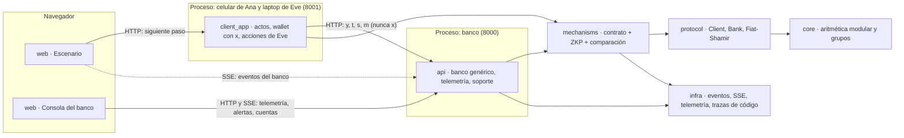

# Schnorr Lab

[](https://github.com/Djch18AtSchool/schnorr-lab/actions/workflows/tests.yml)

Laboratorio de **autenticación bancaria sin contraseñas** con una prueba de conocimiento cero: el **protocolo de identificación de Schnorr**, implementado desde cero en Python. El cliente demuestra al banco que conoce una clave secreta *x* sin enviarla nunca; el banco guarda solo la clave pública *y = g<sup>x</sup> mod p*.

El entregable es el propio sistema funcionando en tiempo real, con dos aplicaciones web:

- **Escenario** (lo que se proyecta): los actores en escena, Ana con su celular y Eve con su laptop. Cada acto (inicio de sesión, espía, robo de la base, impostor…) se ejecuta de verdad contra el banco, paso a paso, con un diagrama de secuencia vivo y la terminal del banco que muestra el log y la línea de código que decidió.
- **Consola del banco**: lo que ve el servidor, que no sabe qué acto se representa. Actividad en vivo, alertas deducidas de las peticiones, lo que guarda de cada cliente y los resultados de todos los experimentos.

El banco y el proceso del celular (que guarda *x*) corren como procesos separados y hablan solo por HTTP.

> Proyecto del curso **Matemática Discreta 2** (FUN-03), Universidad CENFOTEC, C3-2026. Docente: Rebeca Paola Chaves Morales.
> Integrantes: Maximiliano Badilla Cerdas, Braden Lee Knuter Cordoba, Dylan Josue Chaves Hernández y Dylan Gabriel Piña Moya.
>
> Es un **modelo educativo**: implementa la matemática discreta que sustenta la autenticación. No debe usarse en producción; un sistema real usa bibliotecas criptográficas auditadas.

## Cómo ejecutarlo

Requiere **Python 3.12**. La web ya viene compilada en `web/dist`, así que no hace falta Node para usarla. Desde la raíz del repositorio:

```bash
uv sync --all-groups               # crea .venv con Python 3.12 e instala todo; bench agrega gmpy2, solo para comparar implementaciones
source .venv/bin/activate          # Windows: .venv\Scripts\activate (o antepone `uv run` a cada comando)
```

| Comando | Qué hace |
| --- | --- |
| `python lab.py` | Arranca el banco (8000) y el celular (8001). **Escenario:** http://127.0.0.1:8001/ · **Consola:** http://127.0.0.1:8000/consola/ · **Swagger:** http://127.0.0.1:8000/docs |
| `pytest` | 376 pruebas y la tabla de trazabilidad requerimiento → prueba → resultado (también la guarda en `results/tests.json`) |
| `python -m benchmark.compare` | Compara el ZKP con contraseña, TOTP y SRP (unos 20 s) |
| `python -m benchmark.experiments` | Impostor, simulador, r repetido, repetición, aleatoriedad y aritmética (unos 7 s) |
| `python -m benchmark.latency` | Vuelve a medir la latencia según los bits de p (unos 30 s) |
| `python demo.py --verbose --option 1` | El ejemplo del escrito (p = 23) paso a paso en la consola |

Para modificar la web: `cd web && npm ci && npm run dev` (con el banco y el celular corriendo) y, al terminar, `npm test` y `npm run build`.

Otras formas de usarlo: `uvicorn api.app:app` levanta solo el banco (Swagger en http://127.0.0.1:8000/docs); `python http_client.py` inicia sesión por HTTP mostrando lo que viaja; `python lab.py --group rfc-2048` arranca con un grupo de 2048 bits.

## Qué se ve en la demostración

**Escenario** (http://127.0.0.1:8001/). El panel «Dirección» (tecla `D`) elige el acto, el grupo, la velocidad y las animaciones; `→` o `Espacio` avanzan, `C` muestra el plano general. La cámara enfoca a quien actúa: el celular de Ana (una app bancaria realista, sin nada técnico), el mensaje que viaja, la terminal del banco o la laptop de Eve. La tarjeta lateral explica cada paso con sus números.

| Acto | Qué muestra |
| --- | --- |
| Registro | Ana crea su cuenta: el celular genera x y el banco guarda solo y |
| Inicio de sesión | Compromiso, reto y respuesta; el banco verifica g^s ≡ t·y^c |
| Inicio sin interacción | Fiat-Shamir: un solo mensaje con c = SHA-256(…) |
| Espía repite la respuesta | Eve copia el inicio de sesión de Ana y reenvía s: la sesión ya se usó |
| Robo de la base de datos | Eve obtiene solo claves públicas; con p = 23 despeja x con BSGS y entra, con 2048 bits no |
| Impostor | Eve adivina retos sin x; al tercer fallo la cuenta se bloquea, también para Ana |
| Espía repite la prueba | El banco recuerda las pruebas no interactivas usadas |
| Celular que repite r | Un celular defectuoso repite r: Eve despeja x con Euclides y entra |

**Consola del banco** (http://127.0.0.1:8000/consola/): Resumen (indicadores y cada petición en el tiempo), Actividad (cada intento params → commit → respond con el log, la función y los cálculos del banco), Seguridad (alertas por dispositivo de origen con su evidencia), Clientes (lo único que guarda: *y*, y la prueba de que *x* nunca llegó), Laboratorio (los 16 experimentos y mediciones), Pruebas (trazabilidad R1–R11 y C1–C5) y Sistema (grupo, mecanismos y API).

**Swagger** (http://127.0.0.1:8000/docs): la API del banco, sin internet; lo que entre por ahí también aparece en la Consola.

## Estado: todos los requerimientos implementados

| ID | Requerimiento (Tabla 4 del escrito) | Dónde | Pruebas |
| --- | --- | --- | --- |
| R1 | Parámetros públicos válidos (p, q primos, p = 2q + 1, g^q ≡ 1) | `core/params.py`, `core/rfc3526.py` | `test_params.py` |
| R2 | El banco guarda solo y | `protocol/bank.py`, `mechanisms/zkp/server.py` | `test_protocol.py`, `test_client_app.py` |
| R3 | r y c nuevos en cada sesión | `protocol/client.py`, `protocol/bank.py` | `test_protocol.py` |
| R4 | Potencia modular rápida propia | `core/modular.py` | `test_modular.py`, `test_backends.py` |
| R5 | Inverso modular con Euclides extendido | `core/modular.py` | `test_modular.py` |
| R6 | Verificación g^s ≡ t·y^c (mod p) | `protocol/bank.py` | `test_protocol.py` |
| R7 | Distintos tamaños de p y su latencia | `core/params.py`, `benchmark/latency.py` | `test_params.py`, `test_latency.py`, `test_protocol.py` |
| R8 | Variante no interactiva (Fiat-Shamir) | `protocol/fiat_shamir.py` | `test_fiat_shamir.py` |
| R9 | Validación de entradas y bloqueo al tercer fallo | `protocol/bank.py`, `api/validation.py` | `test_protocol.py`, `test_api.py` |
| R10 | Laboratorio de ataques | `attacks/`, `client_app/acts/`, `benchmark/experiments.py` | `test_attacks.py`, `test_bsgs.py`, `test_replay.py`, `test_acts.py`, `test_experiments.py`, `test_contracts.py` |
| R11 | Interfaz de revisión | `client_app/`, `api/`, `infra/`, `web/`, `demo.py`, `http_client.py` | `test_acts.py`, `test_observability.py`, `test_client_app.py`, `test_api.py`, `test_demo.py`, `test_infra.py` y las pruebas de `web/` (Vitest) |

Para la comparación con otros mecanismos se agregan los identificadores C1–C5 (se listan después de los R en la trazabilidad):

| ID | Qué cubre | Dónde | Pruebas |
| --- | --- | --- | --- |
| C1 | Registro e inicio de sesión de contraseña, TOTP y SRP | `mechanisms/password/`, `mechanisms/totp/`, `mechanisms/srp/` | `test_password.py`, `test_totp.py`, `test_srp.py` |
| C2 | Qué guarda el banco y qué viaja por la red | `stored_credentials` de cada mecanismo | las mismas |
| C3 | Validación de entradas y bloqueo al tercer fallo | `mechanisms/common.py` (`AttemptLimiter`) | las mismas |
| C4 | Repetición, reuso de códigos y verificación mutua | `mechanisms/totp/otp.py`, `mechanisms/srp/srp6a.py` | las mismas |
| C5 | Experimento de comparación | `benchmark/compare*.py` | `test_compare.py` |

Las pruebas que el segundo avance dejó escritas como contrato (`xfail` estricto) para el informe final hoy pasan todas: no queda ninguna pendiente.

## Resultados del laboratorio

Mediciones en `results/`, regenerables con `python -m benchmark.latency`, `python -m benchmark.experiments`, `python -m benchmark.compare` y el experimento de la base robada (`python demo.py --option 4`). La Consola las grafica en su sección Laboratorio.

**Latencia de una autenticación completa** (mediana de 31 repeticiones; *propia* = nuestra `mod_pow`, *nativa* = `pow` de Python, *gmpy2* = GMP):

| Grupo | Seguridad (bits) | Propia | Nativa | gmpy2 |
| --- | --- | --- | --- | --- |
| safe-256 | < 80 | 0.56 ms | 0.39 ms | 0.14 ms |
| safe-512 | < 80 | 2.68 ms | 1.83 ms | 0.38 ms |
| safe-1024 | 80 | 14.1 ms | 9.84 ms | 1.61 ms |
| rfc-2048 | 112 | 95.9 ms | 65.2 ms | 8.62 ms |
| rfc-3072 | 128 | 294 ms | 210 ms | 25.5 ms |
| ffdhe-2048 (RFC 7919) | 103 | 95.4 ms | 65.0 ms | 8.29 ms |
| ffdhe-3072 (RFC 7919) | 125 | 296 ms | 204 ms | 25.2 ms |
| schnorr-2048 | 112 | 11.1 ms | 9.09 ms | 1.95 ms |
| schnorr-3072 | 128 | 25.7 ms | 21.3 ms | 4.44 ms |

Los grupos ffdhe del RFC 7919 son primos seguros con g = 2 y su seguridad es la que declara el RFC; forman una serie aparte en `results/latency.png`. Cuestan lo mismo que los del RFC 3526 del mismo tamaño.

- **Predicción del escrito (P3).** Al duplicar k el tiempo debía multiplicarse por 2³ = 8 (definición 8). De 1024 a 2048 bits se midió **6.80**: 15 % de error frente a k³. La diferencia no se debe a Karatsuba (k^2.585 → razón ≈ 6): CPython 3.12 multiplica con el método escolar hasta 70 dígitos de 30 bits (unos 2100 bits) y, en los cuadrados, que son la mayoría de las operaciones de la exponenciación, hasta unos 4200 bits. La razón queda bajo 8 por costos que crecen más despacio que k³, como el trabajo fijo del intérprete en cada vuelta, y por eso el error frente a k³ baja a medida que k crece: 41 % de 256 a 512 bits, 15 % de 1024 a 2048 y 9 % de 2048 a 3072.
- **Ajuste del modelo.** Con el **mismo nivel de seguridad**, un grupo de Schnorr (q de 224 bits en lugar de 2047) autentica **8.6 veces más rápido** que el grupo RFC 3526 de 2048 bits, porque los exponentes tienen los bits de q y no los de p.
- **¿Python frente a C?** Los enteros de Python ya están escritos en C, así que nuestra `mod_pow` es solo 1.2–1.5 veces más lenta que `pow` nativo. La diferencia grande la hace la biblioteca: GMP (gmpy2) es 2.8–8.3 veces más rápida que `pow` nativo y 4.1–11.7 veces más que nuestra `mod_pow`. La aritmética es intercambiable (`SCHNORR_ARITHMETIC=propia|nativa|gmpy2`, por defecto *propia*) sin tocar el protocolo, para comparar en igualdad de condiciones.

**Base de datos robada (BSGS, definición 9).** Recuperar *x* a partir de *y* con paso de bebé, paso de gigante cuesta del orden de √q operaciones. Se midió con q de 16 a 40 bits (x recuperada siempre; 0.27 s con 40 bits) y el tiempo crece 0.498 bits por cada bit de q, frente a 0.5 esperado. Extrapolando: **1.5·10¹⁰ años con q de 160 bits** (la edad del universo), 6.5·10¹⁹ años con 224 bits y 4.3·10²⁴ con 256 bits.

**Otras evidencias:**
- La reutilización de r recupera x = 7.
- Las 110 transcripciones simuladas coinciden terna a terna con las reales.
- El impostor acierta cerca de 1/q = 9.09 %.
- Una prueba no interactiva repetida o con m vieja se rechaza.

### Comparación con otros mecanismos

`python -m benchmark.compare` ejecuta los pasos reales del celular de cada mecanismo contra el banco real, en el mismo proceso, con la misma `mod_pow` (*propia*) y, donde aplica, el mismo nivel de seguridad (2048 bits, unos 112 bits). Mediana de 31 repeticiones; los bytes son los de los cuerpos JSON. Resultados en `results/comparacion.{json,csv}` y `results/comparacion_{latencia,red,base_robada}.png`.

| Mecanismo | Registro | Inicio de sesión (sin parámetros) | Viajes | Bytes ↑/↓ | ¿Viaja el secreto? | ¿Se acepta la repetición? | Base robada: diccionario de 10⁶ | 8 caracteres al azar / BSGS |
| --- | --- | --- | --- | --- | --- | --- | --- | --- |
| Contraseña (Argon2id) | 21.3 ms | 21.1 ms | 1 | 53 / 63 | sí | **sí** | 4.6 h | 10^6.2 años |
| Contraseña + TOTP | 24.8 ms | 26.3 ms | 1 | 69 / 63 | la contraseña sí; K solo al enrolar | no (código usado) | 4.6 h, y K está en la base | 10^6.2 años |
| SRP-6a (2048) | 10.2 ms | 30.6 ms (27.1) | 3 | 751 / 1516 | no | no | 44 min (3.4 min con GMP) | 10^5.4 años |
| ZKP · rfc-2048 | 101 ms | 154 ms (103) | 3 | 1303 / 7038 | no | no | no aplica | 10^294 años (BSGS) |
| ZKP · schnorr-2048 | 30.1 ms | 35.7 ms (18.7) | 3 | 754 / 5460 | no | no | no aplica | 6.5·10¹⁹ años (BSGS) |
| ZKP Fiat-Shamir · schnorr-2048 | 27.2 ms | 34.3 ms (16.2) | 2 | 738 / 5354 | no | no | no aplica | 6.5·10¹⁹ años (BSGS) |

- **Latencia.** Con el mismo nivel de seguridad, el ZKP con un grupo de Schnorr (16–19 ms sin descargar parámetros) es tan rápido como Argon2id (21–26 ms, que es lento a propósito) y más rápido que SRP (27 ms). Entre corridas las medianas varían unos pocos ms. Con rfc-2048 cuesta 5 veces más: sus exponentes tienen 2047 bits. Descargar y validar (p, q, g) en cada inicio de sesión suma 17–51 ms al ZKP (la primalidad de p y q) y 4 ms a SRP; se puede cachear.
- **Red.** Contraseña y TOTP usan un solo mensaje, pero la contraseña viaja en él. SRP y el ZKP interactivo usan tres (contando el GET de parámetros) y Fiat-Shamir dos. El ZKP recibe más bytes porque su respuesta incluye los valores intermedios que muestra la interfaz.
- **Base robada.** Argon2id cuesta 16 ms por candidata y el verificador SRP 2.7 ms (0.2 ms con GMP): un diccionario de 10⁶ contraseñas cae en horas o minutos en un solo núcleo. En TOTP el secreto K está en la base. Con el ZKP no hay contraseña que adivinar: hay que resolver el logaritmo discreto.
- **Repetición.** Solo la contraseña acepta el mensaje capturado. TOTP lo rechaza por código usado; SRP y el ZKP, por sesión consumida, y con una sesión nueva, porque la prueba depende de valores efímeros nuevos.
- **Phishing y fuerza bruta en línea** (tabla justificada en `results/comparacion.json`): la contraseña es vulnerable al phishing. TOTP, SRP y el ZKP caen ante un relevo en tiempo real, porque nada de lo que se envía identifica al banco: SRP detecta a un banco falso que responde por su cuenta (no puede producir M2) y el ZKP no entrega nada reutilizable (x nunca sale del celular), pero ninguno detecta a un sitio falso que reenvía los mensajes al banco real en el momento. Todos bloquean al tercer fallo.

## Arquitectura

El código es **agnóstico al mecanismo de autenticación**. El ZKP es el primer mecanismo enchufable; agregar otro no requiere tocar el banco, el celular ni la interfaz.



- **`core/`**: la matemática. Exponenciación rápida, Euclides extendido, grupos (primos seguros, RFC 3526, RFC 7919, grupos de Schnorr) y aritmética intercambiable.
- **`protocol/`**: el protocolo de Schnorr. `Client`, `Bank`, transcripciones y Fiat-Shamir. No sabe de HTTP.
- **`mechanisms/`**: el contrato común (`MechanismInfo` con flujos y pasos explicados, la parte del banco y la parte del celular) y el registro. `mechanisms/zkp/` adapta el protocolo a HTTP y publica cada decisión con su log, la función que la tomó y los cálculos.
- **`infra/`**: la bitácora de eventos con correlación, la transmisión SSE, la telemetría (peticiones, métricas y alertas deducidas por reglas genéricas) y las trazas de código leídas del programa en ejecución.
- **`api/`**: el banco. Monta las rutas de cada mecanismo, la telemetría, las acciones de soporte y sirve la Consola y Swagger.
- **`client_app/`**: el celular de Ana y la laptop de Eve. Guarda *x*, ejecuta los actos paso a paso y sirve el Escenario. Es otro proceso: habla con el banco solo por HTTP, y cada dispositivo se identifica con su propia dirección y User-Agent.
- **`web/`**: el Escenario y la Consola (React + TypeScript + Vite), con el contrato de la API en `web/src/shared/types.ts`.
- **`attacks/` y `benchmark/`**: los experimentos.

Además del ZKP hay tres mecanismos para comparar: `mechanisms/password/` (Argon2id), `mechanisms/totp/` (contraseña + TOTP del RFC 6238) y `mechanisms/srp/` (SRP-6a del RFC 5054, con nuestra `mod_pow`).

**Para agregar un mecanismo** (por ejemplo, una passkey):

1. Crear `mechanisms/<nombre>/` con su `MechanismInfo` (flujos y pasos explicados), su parte del banco (router y `stored_credentials`) y su parte del celular (una función por paso).
2. Registrarlo en `mechanisms/registry.py`.

La auditoría, la telemetría y la Consola lo registran automáticamente. Para mostrarlo en el Escenario, sus flujos se usan en un acto de `client_app/acts/catalog.py`.

### Del diagrama de flujo al código (Tabla 6 del escrito)

| Nodo de la Figura 1 | Función que lo implementa |
| --- | --- |
| Generar o cargar (p, q, g) | `core/params.py` → `get_group` |
| ¿Parámetros válidos? | `core/params.py` → `validate_params` |
| Cliente elige x y calcula y | `protocol/client.py` → `Client.__init__`, `Client.register_payload` |
| ¿y en el subgrupo? / Guardar (id, y) | `protocol/bank.py` → `Bank.register`, con `params.in_subgroup` |
| Cliente elige r y envía t | `protocol/client.py` → `Client.commit` |
| ¿t en el subgrupo? / Banco elige c | `protocol/bank.py` → `Bank.challenge` |
| Cliente calcula s | `protocol/client.py` → `Client.respond` |
| ¿Prueba válida? | `protocol/bank.py` → `Bank.verify`, con `modular.mod_pow` y `modular.mod_inverse` |
| Sumar intento / ¿Menos de 3 fallos? / Bloquear | `protocol/bank.py` → `Bank._fail`, `Bank._abandon_pending_session`, `Bank.is_locked` |

### Objetos y estructuras discretas

| Estructura | Dónde está |
| --- | --- |
| Grupo Zp\* y subgrupo de orden q | `GroupParams(p, q, g)`; pertenencia con `in_subgroup` (u^q ≡ 1 mod p) |
| Enteros modulares y congruencias | `mod_pow`, `mod_inverse` y la comparación g^s ≡ t·y^c en `Bank` |
| Transcripción (t, c, s) | `Transcript`, inmutable |
| Registro id → y | `Bank._users` |
| Sesiones e intentos | `Bank._sessions` (de un solo uso), `Bank._open_sessions` (una pendiente por usuario), `Bank._failures` |
| Conjunto de pruebas usadas | `Bank._used_proofs: set[(t, s)]` (Fiat-Shamir) |
| Diccionario de pasos de bebé | `attacks/bsgs.py` (g^j → j) |

## API del banco

Todos los enteros viajan como **cadenas decimales**, porque JavaScript pierde precisión por encima de 2⁵³. Cualquier campo inesperado (por ejemplo `x`) se rechaza con 422 y queda auditado.

| Método y ruta | Cuerpo | Respuesta |
| --- | --- | --- |
| `GET /zkp/params` | — | `{name, p, q, g, bits}` |
| `POST /zkp/register` | `{user_id, y}` | 201 `{user_id, stored: {y}}`; 400 con `reason` |
| `POST /zkp/login/commit` | `{user_id, t}` | `{session_id, c}`; 400 si t está fuera del subgrupo, 404 si el usuario no existe, 423 si está bloqueado |
| `POST /zkp/login/respond` | `{session_id, s}` | `{accepted, reason, transcript, details, attempts_left}` |
| `POST /zkp/login/nizk` | `{user_id, t, s, m}` | Igual que `/zkp/login/respond` |
| `POST /zkp/demo/client` | `{user_id, x?}` | x e y de un cliente de prueba (solo para Swagger) |
| `POST /password/register`, `POST /password/login` | `{user_id, password}` | 201 `{user_id, stored: {hash}}`; `{accepted, reason, attempts_left}`, 423 si está bloqueado |
| `POST /totp/register` | `{user_id, password}` | 201 `{secret, otpauth_uri, digits, period, stored}` |
| `POST /totp/register/confirm` | `{user_id, code}` | `{accepted, reason, attempts_left}` |
| `POST /totp/login` | `{user_id, password, code}` | `{accepted, reason, attempts_left}`; «Código ya utilizado» si se repite |
| `GET /srp/params` | — | `{name, N, g, hash, bits}` |
| `POST /srp/register` | `{user_id, salt, v}` | 201 `{user_id, stored: {salt, v}}`; 400 si v no cumple 1 < v < N |
| `POST /srp/login/start` | `{user_id, A}` | `{session_id, salt, B}`; 400 si A ≡ 0 (mod N), 404, 423 |
| `POST /srp/login/verify` | `{session_id, M1}` | `{accepted, reason, M2, attempts_left}` |
| `GET /mechanisms` | — | Mecanismos, flujos y pasos, y el grupo en uso |
| `GET /bank/users`, `GET /bank/accounts` | — | Lo que guarda el banco; las cuentas con estado, intentos y dispositivos vistos |
| `GET /audit/log` | — | Todo cuerpo recibido, en orden (`valid: false` si se rechazó), con su hora y petición |
| `GET /events`, `GET /events/stream` | — | Eventos del banco (JSON o en vivo por SSE) |
| `GET /telemetry/summary`, `/telemetry/requests`, `/telemetry/requests/{id}`, `/telemetry/alerts` | — | Métricas, peticiones (una con su log, código y cálculos) y alertas deducidas |
| `POST /admin/accounts/{m}/{u}/unlock`, `DELETE /admin/accounts/{m}/{u}` | — | Soporte: desbloquear o dar de baja una cuenta (sin autenticación: es un laboratorio) |
| `GET /lab/tests`, `GET /lab/results` | — | Resultado de las pruebas y archivos de `results/` |
| `POST /lab/reset` | `{group?}` | Reinicia el banco, opcionalmente con otro grupo (solo laboratorio) |

El proceso del celular (8001) expone `GET /api/config`, `GET|POST /api/acts`, `POST /api/acts/{id}/next`, `POST /api/acts/{id}/run`, `POST /api/lab/reset`, `GET /api/wallet` y `GET /api/events[/stream]`.

## Decisiones de implementación

- **Rango de r.** El cliente toma r ∈ [1, q − 1] (Tabla 1). Por eso, con p = 23, hay q·(q − 1) = 110 transcripciones posibles; el simulador descarta t = 1, que un cliente honesto nunca envía.
- **Intentos abandonados.** Cada usuario tiene a lo sumo una sesión pendiente. Pedir un reto nuevo sin responder el anterior cuenta como intento fallido, así el bloqueo limita de verdad al impostor: 1 − (1 − 1/q)³.
- **Fiat-Shamir.** c = SHA-256(p ‖ g ‖ y ‖ t ‖ id ‖ m) mod q con codificación de longitud fija (RFC 8235). Una prueba repetida o con m fuera de la ventana de 30 s se rechaza, y esos rechazos no cuentan como fallos, para que un espía no pueda bloquear a la víctima. Con p = 23 solo existen 110 pares (t, s): tras varios inicios de sesión aparece «Prueba ya utilizada» incluso para el cliente honesto, otra razón por la que el grupo de ejemplo solo sirve para aprender.
- **Grupos RFC 3526.** Los primos se copiaron del texto del RFC y una prueba los verifica contra la fórmula con π de cada sección.
- **Proceso del celular aparte.** La app del celular guarda *x* y habla con el banco por HTTP, como en la realidad. El Escenario solo lee las vistas del banco (CORS limitado al origen del celular) y nunca envía secretos.
- **El banco no se reinicia entre actos.** Conserva cuentas, auditoría e historial como un servicio real. Si un acto lo necesita, soporte desbloquea la cuenta de Ana o la da de baja, y esa acción se ve en la Consola. Solo cambiar de grupo reinicia el banco, porque equivale a desplegar uno nuevo.
- **El banco no sabe qué acto ocurre.** Las alertas se deducen de las peticiones con reglas genéricas; los mecanismos solo informan señales (`auth.ok`, `auth.replay`, `auth.lockout`…).
- **Mecanismos de comparación.** La auditoría y los eventos de `password` y `totp` muestran la contraseña tal como llegó, y los de SRP muestran S y K: es a propósito, para ver en el laboratorio qué recibe el banco; un sistema real no los registraría. Contraseña y TOTP responden igual a usuario inexistente y a contraseña incorrecta; SRP y el ZKP responden 404. El intento se cuenta antes de verificar, así las peticiones en paralelo no esquivan el bloqueo.

## Convenciones del código

- Identificadores en inglés; comentarios, docstrings y mensajes en español. Cada función pública indica el requerimiento que cubre («Cubre R4.») y la definición del escrito que implementa.
- Dentro de `core/`, `protocol/` y `attacks/` no se usa `pow(a, b, n)`: siempre `mod_pow` y `mod_inverse`. La única excepción es el despacho de la aritmética intercambiable.
- Aleatoriedad solo con `secrets`. Tipos en todas las firmas públicas y `dataclass(frozen=True)` para los valores.
- GitHub Actions corre las pruebas de Python y de la web (typecheck, Vitest y build) en cada cambio.

## Referencias

- Schnorr, C. P. (1991). Efficient signature generation by smart cards. *Journal of Cryptology, 4*(3), 161–174.
- Fiat, A. y Shamir, A. (1987). How to prove yourself: Practical solutions to identification and signature problems. En *Advances in cryptology — CRYPTO ’86* (pp. 186–194). Springer.
- Menezes, A. J., van Oorschot, P. C. y Vanstone, S. A. (1996). *Handbook of applied cryptography*. CRC Press.
- Katz, J. y Lindell, Y. (2020). *Introduction to modern cryptography* (3.ª ed.). CRC Press.
- Rosen, K. H. (2019). *Discrete mathematics and its applications* (8.ª ed.). McGraw-Hill Education.
- Barker, E. (2020). *Recommendation for key management: Part 1 – General* (NIST SP 800-57 Part 1, Rev. 5).
- Hao, F. (2017). *Schnorr non-interactive zero-knowledge proof* (RFC 8235). IETF.
- Kivinen, T. y Kojo, M. (2003). *More modular exponential (MODP) Diffie-Hellman groups for IKE* (RFC 3526). IETF.
- Gillmor, D. (2016). *Negotiated finite field Diffie-Hellman ephemeral parameters for TLS* (RFC 7919). IETF.
- Wu, T. (2000). *The SRP authentication and key exchange system* (RFC 2945). IETF.
- Taylor, D., Wu, T., Mavrogiannopoulos, N. y Perrin, T. (2007). *Using the Secure Remote Password (SRP) protocol for TLS authentication* (RFC 5054). IETF.
- M'Raihi, D., Machani, S., Pei, M. y Rydell, J. (2011). *TOTP: Time-based one-time password algorithm* (RFC 6238). IETF.
- OWASP Foundation. (2024). *Password storage cheat sheet*. https://cheatsheetseries.owasp.org/cheatsheets/Password_Storage_Cheat_Sheet.html
